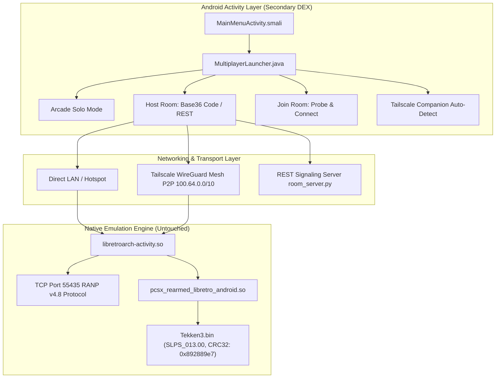

# 🥋 Tekken 3 Android Multiplayer — Zero-Mod Netplay & Tailscale P2P Engine

[-3DDC84?style=for-the-badge&logo=android&logoColor=white)](https://developer.android.com)
[](https://www.retroarch.com)
[](https://github.com/libretro/pcsx_rearmed)
[](https://docs.libretro.com/guides/netplay-faq/)
[](https://tailscale.com)
[]()

An advanced, production-grade reverse engineering and non-invasive launcher architecture that brings seamless **online and local two-player multiplayer (60 FPS)** to the extracted standalone Android Tekken 3 package (`com.androidapks.tekken3`).

Built with a **zero-modification invariant**: no hex-patching of the PlayStation 1 game ROM and no recompilation of the native emulator libraries.

---

## ⚡ Highlights & Innovations

- 🔒 **Zero-Modification ROM Invariant:** Preserves the exact CRC32 (`0x892889e7`) and SHA-256 (`0F059C80...`) of `Tekken3.bin`. This ensures full frame rollback determinism and avoids netplay rejection caused by ROM checksum mismatch.
- ⚙️ **Untouched Native Core:** Both `libretroarch-activity.so` and `pcsx_rearmed_libretro_android.so` remain 100% byte-for-byte identical to the original release.
- 🕹️ **Arcade Retro In-App Launcher:** Authentic arcade theme (Carbon `#08090C`, `#FF2A00`–`#FFCC00` fire borders, arcade typography) integrated into the Android Activity lifecycle (`classes2.dex`).
- 🌐 **Tailscale Companion Mesh Networking (Model B):** Play over the internet across any network (Wi-Fi, 4G, 5G) without router port-forwarding or cloud hosting costs. Features auto Carrier-Grade NAT (`100.64.0.0/10`) interface detection.
- 🚀 **Zero-Infrastructure Base36 Smart Room Codes:** Generates compact room codes (e.g. `TK-1QJNZ2` $\leftrightarrow$ `192.168.1.50`) that pack IPv4 addresses directly. Allows offline/direct peer-to-peer matchmaking with zero external server dependencies.
- 📡 **Lightweight Signaling Server:** Includes a high-performance Python REST service (`room_server.py`) for automated room creation, polling, and player rendezvous.
- 🛡️ **Modern Android 13/14 Compatibility:** Fixes `ListActivity.onContentChanged()` layout invariants, bypasses legacy 5-second `firstLaunch` process termination, handles Android 13 scoped storage permissions, and loads secondary DEX via MultiDex.

---

## 🏗️ Architecture Overview



---

## 🎮 How to Play

### Scenario 1: Online Multiplayer Anywhere (Tailscale P2P)

Play with friends over cellular data or different Wi-Fi networks without opening router ports:

1. **Install Tailscale:** Both players install the official [Tailscale](https://tailscale.com/download/android) app from Google Play on their Android devices and sign in.
2. **Share Node / Connect:** Ensure both phones are connected on the same tailnet (or share Phone 1's node to Phone 2 via the Tailscale admin console). Both devices will have a `100.x.y.z` IP address.
3. **Launch Tekken 3:** Open the game. The top banner will indicate:
   ```
   ● TAILSCALE ACTIVE: 100.x.y.z (REMOTE READY)
   ```
4. **Host Player (Phone 1):**
   - Tap **★ MULTIPLAYER MODE ★** $\rightarrow$ **CREATE ROOM**.
   - Note the 6-character room code (e.g., `TK-RU7KM9`).
   - Tap **📋 COPY CODE** or **📤 SHARE** to send it to your friend.
   - Tap **START FIGHT**. When the game loads:
     1. Tap the **Space Invader icon** (between health bars at top center).
     2. Tap the **Home icon** (right sidebar).
     3. Scroll to **Netplay** $\rightarrow$ tap **Start Netplay Host**.
     4. RetroArch confirms: `Netplay server started on port 55435`.
5. **Guest Player (Phone 2):**
   - Tap **★ MULTIPLAYER MODE ★** $\rightarrow$ **JOIN ROOM**.
   - Paste the room code and tap **VALIDATE & PROBE**.
   - Launcher performs a pre-flight TCP probe to confirm Host is live.
   - Tap **CONNECT & FIGHT**. When the game loads:
     1. Tap **Space Invader icon** $\rightarrow$ **Home icon** $\rightarrow$ **Netplay**.
     2. Tap **Connect to Netplay Host** (Host IP is pre-configured).
     3. RetroArch confirms: `Connected to Netplay Host!`.
6. **Fight!**
   - Host controls **Player 1** (Left), Guest controls **Player 2** (Right).

---

### Scenario 2: Local Play (Hotspot or Same Wi-Fi)

- **Portable Hotspot (Lowest Latency, 1–3 ms):** Host turns on Wi-Fi hotspot; Guest connects to Host's hotspot. Follow the same Create/Join steps.
- **Home/Office Wi-Fi:** Both phones connect to the same router. The Base36 room code encodes the local IP (e.g. `192.168.1.x`) automatically.

---

## 📁 Repository Structure

```
├── AGENT.md                               # Project progress tracking & milestone status
├── MEMORY.md                              # Deep technical knowledge base & memory map
├── MULTIPLAYER_BUILD_REPORT.md            # Smali injection & APK packaging audit
├── MULTIPLAYER_REMOTE_READINESS_AUDIT.md  # WAN readiness & NAT traversal evaluation
├── MULTIPLAYER_ROOM_IMPLEMENTATION_REPORT.md # UI design & room code UX report
├── TAILSCALE_INTEGRATION_FEASIBILITY.md   # Architectural evaluation of VPN options
├── TAILSCALE_POC_BUILD_REPORT.md          # Tailscale companion PoC & test reports
│
├── analysis/                              # Reverse engineering scripts & custom source
│   ├── MultiplayerLauncher.java           # Main custom UI & networking launcher source
│   ├── compile_launcher.py                # Automated build, stubbing, DEX & smali pipeline
│   ├── room_server.py                     # Standalone Python REST signaling server
│   ├── verify_build.py                    # Hash and byte-level ROM purity validator
│   ├── test_room_lifecycle.py             # Signaling server endpoint test suite
│   ├── test_tailscale_poc.py              # 509 automated unit tests for networking logic
│   ├── test_handshake.py                  # Live RANP socket handshake probe
│   │
│   ├── disasm_intent.py                   # Intent parameter reverse engineering
│   ├── find_netplay_flag.py               # Memory flag scanner (0xb9ac7d)
│   ├── find_netplay_mode_adrp.py          # ADRP instruction resolver
│   ├── inspect_cli_parse.py               # Command-line parser auditor
│   │
│   └── reports/                           # Technical research reports
│       ├── TWO_DEVICE_TEST_GUIDE.md       # Complete physical testing guide
│       ├── HOST_JOIN_IMPLEMENTATION_PLAN.md
│       ├── NETPLAY_HOST_VALIDATION_RESULTS.md
│       ├── NETPLAY_VALIDATION_PLAN.md
│       └── INITIAL_APK_ANALYSIS.md
```

---

## 🔬 Reverse Engineering Findings

Detailed findings from auditing `libretroarch-activity.so`:

### 1. Intent Handling & CLI Restrictions
- Subroutine at `0x5ed8c0` only parses `"CONFIGFILE"`, `"LIBRETRO"`, `"ROM"`, `"SDCARD"`, `"EXTERNAL"`, `"DATADIR"`, and `"APK"`.
- Command-line arguments (`--host`, `-H`, `-C`) are not exposed via Android Intent extras, requiring configuration file injection.

### 2. Engine Boot Netplay Wipe
- Netplay runtime state is stored at virtual address `0xb9ac7d` (`0x0001` = host, `0x0101` = client).
- On Android `NativeActivity` initialization, `retroarch_main_init` unconditionally clears this flag:
  ```arm64
  0x0060c2b4: strb wzr, [x8, #0xc7c]   ; Clears active netplay state on boot
  ```
- Because headless auto-hosting is wiped on boot, hosting must be triggered through the menu action (`action_ok_netplay_sublist` at `0x6b9330`).

### 3. Netplay Protocol Handshake
Connecting to port `55435` captures the 24-byte RetroArch NetPlay (`RANP`) header:
```
b'RANP\x00\x04\x00\x08\x00\x00\x00\x01\x00\x00\x00\x00\x00\x00\x00\x05\x00\x00\x05\x89'
```
- **Magic:** `RANP`
- **Protocol Version:** `0x0004`, `0x0008` (Version 4.8)
- **Mode:** `0x00000001` (Host Mode active)

---

## 🛠️ Building & Customizing

### Prerequisites
- Python 3.9+
- JDK 8 or 17
- Android SDK Platform Tools & Build Tools (`d8`)
- [Apktool](https://apktool.org/) v2.9+

### 1. Compile Launcher Source
The build script creates Android stubs, compiles `MultiplayerLauncher.java`, runs `d8` to generate `classes.dex`, and disassembles it into `smali_classes2`:

```bash
python analysis/compile_launcher.py
```

### 2. Run Automated Verification Tests
Run the automated test suites to ensure networking, Base36 encoding, and room server integrity:

```bash
# Test Tailscale detection, IP prioritization, Base36 coding, & socket probes (509 tests)
python analysis/test_tailscale_poc.py

# Test REST signaling server endpoints
python analysis/test_room_lifecycle.py
```

### 3. Run the Signaling Server (Optional)
To host your own room rendezvous server:

```bash
python analysis/room_server.py --port 8080
```

---

## ⚖️ Legal & Disclaimer

- **Educational & Research Purpose:** This repository contains reverse engineering analysis, standalone launcher source code, and build toolchains created for interoperability and preservation research under Fair Use.
- **No Copyrighted ROMs Included:** In compliance with copyright laws and GitHub Terms of Service, this repository **does not** host or distribute copyrighted PlayStation 1 BIOS, disc images (`Tekken3.bin`), or proprietary ROM assets.
- **Trademarks:** *Tekken 3* and *Tekken* are registered trademarks of Bandai Namco Entertainment Inc. *PlayStation* is a registered trademark of Sony Interactive Entertainment Inc. *RetroArch* is a trademark of the Libretro team. This project is not affiliated with, endorsed by, or associated with Bandai Namco, Sony, or Libretro.

---

## 🤝 Contributing & License

Contributions, bug reports, and optimizations are welcome! Feel free to open an issue or submit a pull request.

Licensed under the [MIT License](LICENSE).
